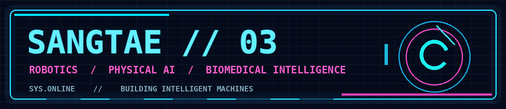
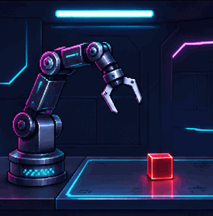
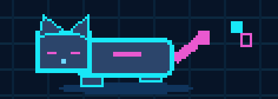

### `> SYSTEM ONLINE_` &nbsp; `> BUILD · TEST · LEARN_`

**Robotics · Physical AI · Computer Vision · Biomedical AI**

---

### `01 // ROBOTIC MANIPULATION` 

<table>
<tr>
<td width="51%" align="center">
  
   SO-101-inspired · pick → grasp → move → place
</td>
<td valign="middle">

<strong>Hello, I'm Sangtae.</strong> 👾

I explore how intelligent systems <strong>perceive, decide, and act</strong>—from vision-guided robot manipulation to biomedical signal processing.

<ul>
<li>🤖 <strong>Robot manipulation</strong> — SO-101, imitation learning, pick &amp; place</li>
<li>👁️ <strong>Robot perception</strong> — YOLO, 3×3 slot localization, camera calibration</li>
<li>🦾 <strong>Sim-to-real</strong> — Isaac Sim, ROS 2, real hardware integration</li>
<li>🫀 <strong>Biomedical AI</strong> — wavelets, CNN–Transformer, ECG denoising</li>
<li>🔬 <strong>Currently building</strong> — reliable action pipelines for Physical AI</li>
</ul>
</td>
</tr>
</table>

### `02 // TECH STACK`

### `03 // RESEARCH MISSIONS`

| Mission | Tech & focus | Status |
|:--|:--|:--|
| **SO-101 Robot Arm** | Robot control · YOLO · imitation learning · vision-guided pick & place | `IN PROGRESS` |
| **Physical AI / Sim-to-Real** | Isaac Sim · ROS 2 · action contracts · robot execution pipeline | `RESEARCH` |
| **ECG Signal Restoration** | Wavelets · compact CNN–Transformer · ECG denoising | `RESEARCH` |
| **Robotics MCP Hub** | Curated robotics, simulation, perception & Physical AI resources | [**OPEN REPO**](https://github.com/sangtae03/robotics-mcp-hub) |

> **Focus:** Getting real robots to reliably execute the actions that AI policies predict.

### `04 // DEVELOPER TELEMETRY`

Statistics and trophies are third-party estimates, **not official GitHub global rankings**. Cards may intermittently be unavailable.

### `05 // CONTRIBUTION SNAKE`

Auto-generated daily by GitHub Actions. It appears after the first successful `Generate Contribution Snake` run.

### `06 // CYBER COMPANION & ARCADE`

**`MEOW.EXE // ONLINE`**

Move with **WASD / Arrow Keys**, press **Space** to pick or drop the cube. On mobile, use the on-screen controls.

---

`NEURAL LINK ACTIVE` · `SIM → REAL` · `CODE → MOTION`

Made with curiosity, robotics, and too much coffee. 🤖

